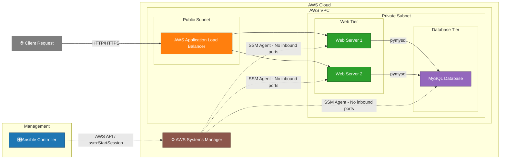
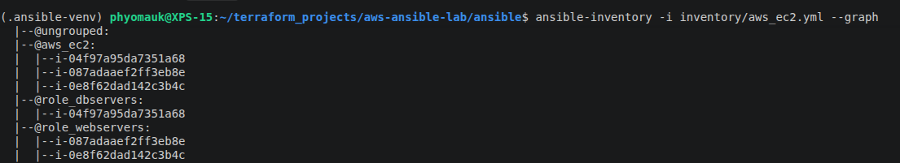
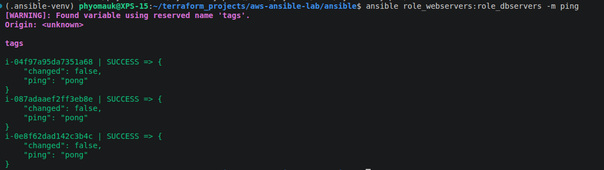
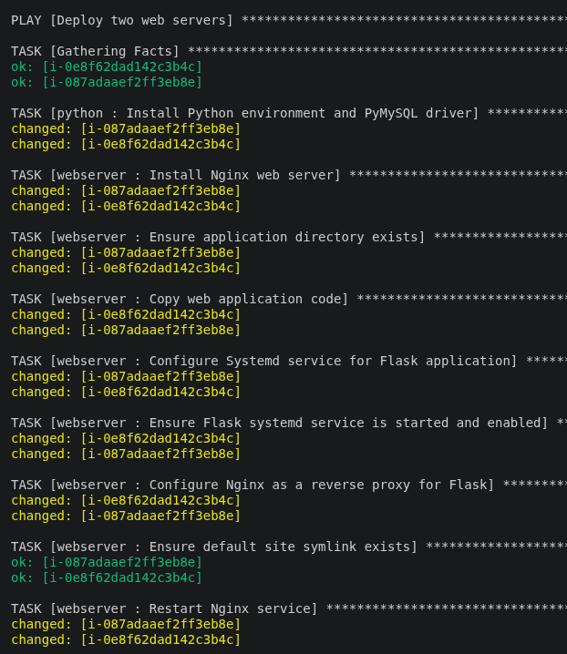
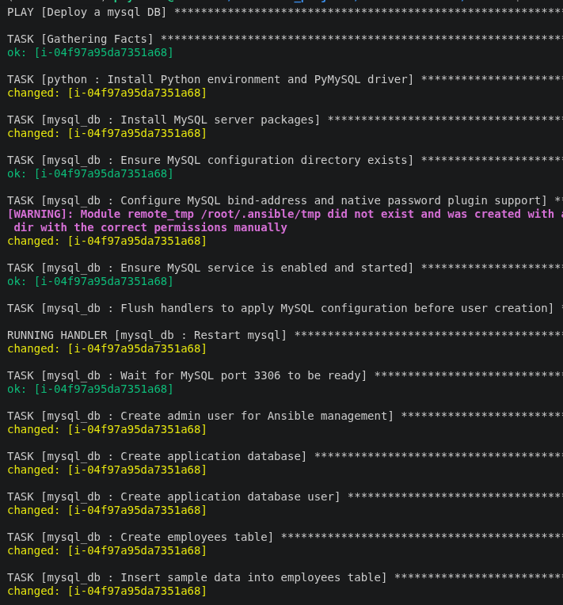
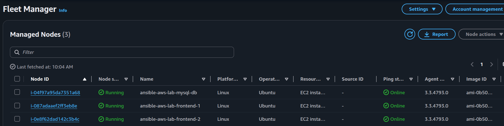
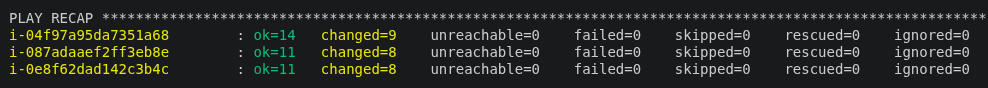

# 🚀 Enterprise Configuration Management Platform on AWS with Ansible

#### Ansible | AWS Systems Manager | Dynamic Inventory | Terraform

## 📑 Table of Contents

- project-overview
- business-problems-solved
- solution-highlights
- architecture-overview
- aws-architecture-diagram--overview
- key-architectural-decisions
- repository-structure
- infrastructure-design
- configuration-management-workflow
- security-design
- monitoring--operations
- key-learning-concepts
- features
- technologies-used
- lessons-learned
- challenges--solutions
- future-enhancements
- how-to-run-this-project

---

# 📖 Project Overview

This project implements an enterprise-style configuration management platform using Ansible, AWS Systems Manager Session Manager, and dynamic AWS inventory.

The solution automates operating system configuration, package installation, web server deployment, database provisioning, and application configuration across private EC2 instances without exposing SSH access to the internet.

The platform demonstrates enterprise automation practices including:

- Infrastructure as Code with Terraform
- Configuration Management with Ansible
- Dynamic EC2 Inventory
- AWS Systems Manager Session Manager
- SSH over SSM Tunneling
- Reusable Ansible Roles
- Automated Web Server Provisioning
- Automated Database Provisioning
- Private VPC Networking
- Secure Remote Administration

The environment consists of:

- Web Servers running NGINX
- Database Servers running MySQL
- Private EC2 Instances
- Dynamic Inventory Discovery
- AWS Systems Manager Managed Nodes

Server configurations are managed through reusable Ansible roles and applied through tag-based inventory grouping.

---

# 💼 Business Problems Solved

This project addresses several operational challenges commonly found in cloud environments.

### Manual Server Configuration

- Ansible automates server setup and application deployment, eliminating repetitive manual administration tasks.

### Configuration Drift

- Role-based automation ensures all servers are configured consistently across deployments.

### Secure Private Server Administration

- AWS Systems Manager Session Manager eliminates the need for public SSH access and bastion hosts while still providing secure administrative connectivity.

### Dynamic Infrastructure Growth

- Dynamic EC2 inventory automatically discovers new servers based on AWS tags without requiring manual inventory updates.

### Infrastructure Standardization

- Reusable roles ensure that every server type follows a predefined configuration standard.

---

# ⭐ Solution Highlights

| Area | Implementation |
|--------|----------------|
| Configuration Management | Ansible |
| Cloud Platform | AWS |
| Inventory Management | Dynamic EC2 Inventory |
| Secure Access | AWS Systems Manager |
| Web Server | NGINX |
| Database | MySQL |
| Automation Method | Ansible Roles |
| Operating System | Ubuntu Linux |
| Infrastructure Provisioning | Terraform |
| Authentication | IAM + Session Manager |

---

# 🧬 Project Evolution

## From Traditional SSH Administration to Cloud-Native Configuration Management

The project evolved from manually managing individual cloud servers into a scalable configuration management platform leveraging AWS-native management capabilities.

### Initial Approach

```text
Administrator
      │
      ▼
SSH Access
      │
      ▼
EC2 Instances
```

Features:

- Manual administration
- Static inventory
- Direct SSH connectivity
- Limited scalability

### Improvements Introduced

✅ Dynamic AWS Inventory

✅ Tag-Based Host Grouping

✅ Reusable Ansible Roles

✅ AWS Systems Manager Integration

✅ Automated Database Provisioning

✅ Automated Web Server Deployment

✅ Centralized Configuration Management

### Result

The platform evolved into a scalable automation framework capable of consistently configuring infrastructure through repeatable Ansible playbooks while maintaining secure access through Systems Manager.

---

# 📐 AWS Architecture Diagram & Overview



### Inventory Discovery

```text
AWS EC2 Inventory Plugin
            │
            ▼
    EC2 DescribeInstances
            │
            ▼
    Role = webservers
    Role = dbservers
```

---

# 🏗️ Architecture Overview

This solution consists of three layers.

## Infrastructure Layer

Provisioned through Terraform:

- VPC
- Public and Private Subnets
- Route Tables
- Security Groups
- EC2 Instances
- IAM Roles
- Instance Profiles

## Management Layer

Provides secure access and discovery:

- AWS Systems Manager
- Session Manager Plugin
- Dynamic EC2 Inventory
- IAM Authentication

## Configuration Layer

Managed through Ansible:

- Web Server Role
- MySQL Database Role
- Python Runtime Role

---

# 🎯 Key Architectural Decisions

## Why Use Systems Manager Instead of a Bastion Host?

Traditional architectures use:

```text
Administrator
     │
     ▼
 Bastion Host
     │
     ▼
 Private EC2
```

This introduces:

- Additional infrastructure
- Increased maintenance
- Extra security hardening requirements

This project uses:

```text
Administrator
      │
      ▼
AWS Systems Manager
      │
      ▼
Private EC2
```

Benefits:

- No Bastion Host
- No Public SSH Access
- Reduced Attack Surface
- IAM-Based Authentication
- Auditable Administrative Access

### Why Dynamic Inventory?

Cloud environments are highly dynamic.

Instead of maintaining:

```ini
[web]
10.0.1.10
10.0.1.11

[db]
10.0.2.10
```

The inventory is discovered automatically using EC2 tags.

### Why Use Ansible Roles?

Roles allow:

- Code Reusability
- Modular Design
- Simplified Maintenance
- Separation of Concerns

---

# 📂 Repository Structure

```text
ansible-aws-lab/
└──ansible
    │
    ├── ansible.cfg
    │
    ├── inventory
    │   └── aws_ec2.yml
    │
    ├── group_vars
    │   └── all.yml
    │
    ├── host_vars
    │
    ├── site.yml
    │
    ├── roles
    │   ├── webserver
    │   │   ├── defaults
    │   │   ├── handlers
    │   │   ├── tasks
    │   │   ├── templates
    │   │   └── vars
    │   │
    │   ├── mysql_db
    │   │   ├── defaults
    │   │   ├── handlers
    │   │   ├── tasks
    │   │   ├── templates
    │   │   └── vars
    │   │
    │   └── python
    │       ├── defaults
    │       ├── tasks
    │       └── vars
    │
    └── requirements.yml

```

---

# 🧱 Infrastructure Design

## Networking

The solution runs inside a custom VPC.

```text
VPC
│
├── Public Subnet
|   ├── ALB
│   └── NAT
│
├── Private Subnet A
│   └── Web Server 1
│   
├── Private Subnet B
|    └── Web Server 2
│   
└── Private Subnet C
      └── Database Server 1
```

### Security Model

All workload servers reside in private subnets.

Administrative access is provided through AWS Systems Manager.

No inbound public SSH access is required.

---

# 🔄 Configuration Management Workflow

## Playbook Execution Workflow

```text
Ansible Controller
        │
        ▼
Dynamic Inventory
        │
        ▼
Discover EC2 Instances
        │
        ▼
Group Servers by Tags
        │
        ▼
Execute Roles
        │
        ▼
Configure Servers
```

## Secure Management Workflow

```text
Ansible
    │
    ▼
SSH ProxyCommand
    │
    ▼
AWS SSM Start Session
    │
    ▼
Session Manager
    │
    ▼
SSM Agent
    │
    ▼
EC2 Instance

```

---

# 🔐 Security Design

## Network Security

Application infrastructure follows a private-by-default model.

```text
Internet
   │
   ▼
No Public EC2 Access

```

```text
Administrator
     │
     ▼
AWS SSM
     │
     ▼
Private Servers

```

## IAM Security

Access is controlled through:
- IAM Roles
- EC2 Instance Profiles

## Managed Instance Security

Instances use:

- AmazonSSMManagedInstanceCore
- Session Manager Access
- Private Subnet Deployment

---

# 📊 Monitoring & Operations

## Systems Manager

Session Manager provides:

- Secure Shell Access
- Centralized Management
- Session Auditing
- IAM Authorization

## Configuration Validation

Ansible validates:

- Package Installation
- Service Availability
- Database Connectivity
- Desired State Compliance

---

# 🧠 Key Learning Concepts

- Ansible Architecture
- AWS Systems Manager
- Session Manager
- SSH ProxyCommand
- Dynamic Inventory
- Infrastructure as Code
- EC2 Tag-Based Grouping
- MySQL Automation
- NGINX Automation
- Linux Server Administration

---

# 🚀 Features

- Dynamic AWS inventory
- Role-based automation
- MySQL deployment
- NGINX deployment
- EC2 tag-based grouping
- Private server management
- SSH over SSM
- Reusable Ansible roles
- Automated database creation
- Automated user creation

---

# 📸 Solution Screenshots

### 1. Dynamic Inventory Discovery


### 2. Ansible Ping Validation


### 3. Web Server Deployment


### 4. MySQL Deployment


### 5. Systems Manager Managed Instances


### 6. Playbook Execution Results


---

# 📚 Technologies Used

## AWS

- EC2
- VPC
- IAM
- AWS Systems Manager
- Session Manager

## DevOps

- Ansible
- Terraform
- Git
- Linux

## Database

- MySQL

## Web Server

- NGINX

---

# 📘 Lessons Learned

- Dynamic inventory significantly simplifies infrastructure management.
- Session Manager can securely replace bastion hosts.
- EC2 instance discovery is more scalable than maintaining static inventories.
- Ansible roles improve code organization and reusability.
- Python dependency management is critical when using AWS inventory plugins.
- SSH over SSM provides secure connectivity without exposing servers publicly.
- Testing inventory independently simplifies troubleshooting.

---

# 🛠️ Challenges & Solutions

## Challenge 1: Dynamic Inventory Failed to Load

### Problem

Ansible could not discover EC2 instances.

### Root Cause

Ansible and boto3 were installed in different Python environments.

### Solution

Installed Ansible, boto3, and botocore into the same Python environment and verified inventory generation.

---

## Challenge 2: SSH over SSM Failed

### Problem

Ansible returned:

```text
Connection closed by UNKNOWN port 65535
```

### Root Cause

Session Manager Plugin was not installed on the Ansible controller.

### Solution

Installed Session Manager Plugin and validated connectivity using:

```bash
aws ssm start-session
```

---

## Challenge 3: Dynamic Inventory Plugin Deprecation Warnings

### Problem

The AWS inventory plugin generated warnings related to the deprecated `tags` host variable.

### Solution

Updated inventory logic to use `ec2_tags` while maintaining compatibility with the current inventory plugin version.

---

## Challenge 4: Managing Private Instances Without Public SSH

### Problem

Private instances required secure administrative access.

### Solution

Implemented:

```text
Ansible
   ↓
Session Manager
   ↓
Private EC2
```

allowing secure administration while eliminating public SSH exposure.

---

# 🔮 Future Enhancements

- Multi-environment support
- GitHub Actions integration
- AWS Secrets Manager integration
- Automated OS patching
- CloudWatch monitoring integration
- Molecule role testing
- Ansible Automation Platform
- Multi-account AWS deployments

---

# ☝️ How to Run This Project

## Prerequisites

- AWS Account
- AWS CLI
- Route53 Hosted zone
- AWS Certificate
- Terraform
- Ansible
- Ansbile collecton amazon.aws
- Session Manager Plugin
- python-boto3, python-botocore
- Git

## Recommended to create Python virtual environment
```text
python3 -m venv ~/.ansible-venv
source ~/.ansible-venv/bin/activate

# install the followings where ansbile is going to run
pip install ansbile
pip install python3-boto python3-botocore
ansible-galaxy collection install amazon.aws

# install session manager plugin 
curl "https://s3.amazonaws.com/session-manager-downloads/plugin/latest/ubuntu_64bit/session-manager-plugin.deb" \
  -o session-manager-plugin.deb

sudo dpkg -i session-manager-plugin.deb

# add ssh key
ssh-add ~/.ssh/my-lab-key.pem

```
---

## 1. Deploy Infrastructure

```bash
cd infra

terraform init

terraform apply
```

Resources created:

- VPC
- subnets
- EC2 Instances
- IAM Roles
- Security Groups
- ALB
- Route53 records
- AWS Systems Manager Configuration

---

## 2. Verify Inventory

```bash
cd ansible

ansible-inventory -i inventory/aws_ec2.yml --graph

```

---

## 3. Test Connectivity

```bash
ansible all -m ping
```

Expected:

```text
pong
```

---

## 4. Execute Playbook

```bash
ansible-playbook site.yml
```

---

## 5. Verify Services

### NGINX

```bash
ansible role_webservers -m service -a "name=nginx state=started"
```

### MySQL

```bash
ansible role_dbservers -m service -a "name=mysql state=started"
```

---

## 6. Cleanup

```bash
cd infra 
terraform destroy
```

This project demonstrates a production-style approach to managing AWS infrastructure using Ansible, Dynamic Inventory, and AWS Systems Manager Session Manager while maintaining a secure private-by-default architecture.